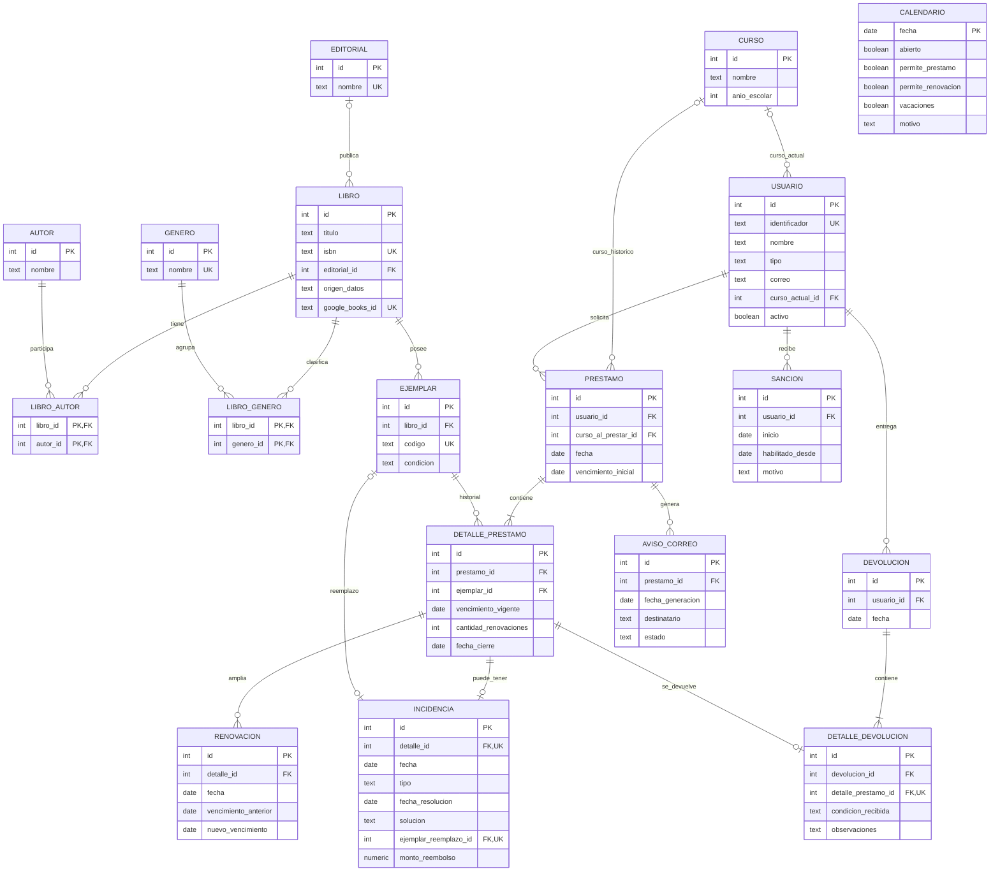

# Modelo de la base independiente

Este es el modelo relacional implementado. Evoluciona la propuesta de las diapositivas para representar calendario, sanciones, incidencias y avisos. Los rectángulos son tablas; PK identifica la clave primaria y FK la clave foránea. Las tablas intermedias resuelven las relaciones N:M del modelo conceptual.

## Cómo leerlo

- Libro describe una edición; Ejemplar identifica la copia física.
- Usuario es la persona que pide libros. No es una cuenta de acceso de la aplicación.
- Préstamo agrupa entre 1 y 3 detalles (la pata de gallo representa varios; el máximo 3 se aplica en SQL).
- Cada detalle admite 0 a 2 renovaciones y 0 a 1 devolución. La clave única de `detalle_devolucion.detalle_prestamo_id` materializa el 1:1 opcional.
- Una devolución puede agrupar varios ejemplares del mismo usuario, incluso de préstamos distintos.
- Una incidencia no es una devolución ficticia. Se resuelve con una reposición o un reembolso; se guarda el cierre del detalle sin crear una entrega del ejemplar perdido.
- La sanción por atraso se obtiene del historial al consultar. La tabla Sanción registra la conducta grave de dos semanas. La deuda y la sanción se comprueban independientemente.
- Calendario es una tabla de referencia consultada por funciones. Se exige cobertura de las fechas utilizadas, sin convertir todos los atributos de fecha en relaciones del diagrama.
- `control_operacion` es una tabla técnica de una fila para coordinar escrituras; no es una entidad del negocio y se omite del gráfico.
- `cambio_calendario` es una bitácora técnica añadida por `06_administracion_calendario.sql`: guarda identificador, instante de registro, período, tipo, motivo, cantidad de días y una captura JSON de los valores anteriores/posteriores. No es una entidad del préstamo y se omite del gráfico de negocio. Sus capturas documentan cambios; no sustituyen la tabla relacional `calendario` que utilizan las reglas.

## Transformación y normalización: base para el informe

Las entidades principales tienen claves propias. Las relaciones 1:N se materializan mediante claves foráneas en el lado N; las N:M Libro–Autor y Libro–Género mediante claves compuestas en tablas intermedias. El 1:1 opcional usa una FK `UNIQUE` en DetalleDevolución. No se requieren entidades débiles para este diseño.

La relación Curso–Préstamo guarda el curso en el momento del préstamo, mientras que Curso–Usuario representa el curso actual. Un cambio de nivel no reescribe el pasado.

Las claves determinan los atributos de su propia tabla: `libro.id → título, ISBN, editorial, año, origen`; `ejemplar.id → libro, código, condición`; `prestamo.id → usuario, fecha, curso histórico, vencimiento inicial`; `detalle.id → préstamo, ejemplar, vencimiento vigente, contador, cierre`. En las tablas de asociación no hay atributos que dependan de una sola parte de su clave. Nombres de editoriales, autores y cursos se separan de los movimientos para evitar duplicarlos.

`vencimiento_vigente`, `cantidad_renovaciones` y `fecha_cierre` son datos derivados materializados para las operaciones. Se conservan mediante triggers y se prohíbe su modificación directa. Su almacenamiento debe explicarse en el informe como decisión de consistencia y acceso, sin ocultar que existe información calculable a partir del historial.

El destinatario de un aviso es una captura del correo al generarlo, no el correo actual del usuario. El plazo de sanción guardado corresponde al calendario usado al registrarla. La nueva administración del calendario rechaza cambios que alterarían fechas utilizadas por movimientos o sanciones. No incluye una reprogramación de vencimientos históricos.

Esta explicación es una base de trabajo, no la justificación formal por cada relación ni los tres diagramas finales exigidos por la guía. El esquema SQL contiene todos los atributos y restricciones, incluidos los no mostrados para facilitar la lectura.
