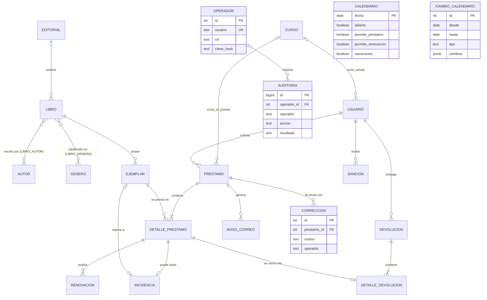

# Modelo E-R, transformación al relacional y normalización

Este documento justifica el esquema implementado en `sql/01_esquema.sql` y las actualizaciones `06` a `10`. Complementa [modelo.md](modelo.md), que describe cada tabla. Las columnas y restricciones listadas aquí se obtuvieron de una base recién inicializada, no de memoria.

## 1. Modelo entidad-relación completo

`CALENDARIO`, `CAMBIO_CALENDARIO` y `CONTROL_OPERACION` no tienen claves foráneas: el calendario se relaciona con préstamos, renovaciones y sanciones por **valor de fecha** mediante funciones (`es_habil`, `sumar_habiles`, `validar_atencion`), no por FK; `CONTROL_OPERACION` es una fila única (`id = 1`) para serializar escrituras de circulación.

### Entidades y decisiones conceptuales

| Entidad | Tipo | Por qué existe |
|---|---|---|
| Libro / Ejemplar | Fuerte / dependiente de Libro | Se presta la copia física (código), no la edición. RN04. |
| Autor, Género, Editorial | Fuertes | Un libro tiene varios autores y géneros (atributos multivaluados → entidades). Editorial opcional. |
| Préstamo / Detalle | Cabecera y detalle | Una operación agrupa 1–3 copias (RN03); cada copia se renueva y devuelve por separado (RN06, RN09). |
| Devolución / Detalle | Cabecera y detalle | Una entrega puede incluir copias de préstamos distintos. |
| Renovación | Débil de Detalle | Historial de cada ampliación (RN06–RN07). |
| Incidencia | 1:1 opcional con Detalle | Pérdida o daño (RN16); la reposición apunta a la copia nueva (1:1 opcional). |
| Sanción | Débil de Usuario | Conducta grave (RN13). La sanción por atraso no se almacena: se calcula (RN12). |
| Aviso de correo | Débil de Préstamo | Cola y registro de envíos (RN19). |
| Corrección | Débil de Préstamo | Anulación con motivo y operador, sin borrar historial. |
| Operador / Auditoría | Fuertes | Cuentas de la aplicación y registro inmutable de quién hizo cada operación. |

## 2. Transformación E-R → relacional

| Regla aplicada | Resultado |
|---|---|
| Cada entidad fuerte → una tabla con clave primaria sustituta `id` (identity). Las claves naturales se conservan como `UNIQUE` (`ejemplar.codigo`, `usuario.identificador`, `libro.isbn`, `operador.usuario`). | `libro`, `autor`, `genero`, `editorial`, `ejemplar`, `curso`, `usuario`, `operador`. |
| Relación 1:N → FK en el lado N. Si la participación del lado 1 es opcional, la FK admite `NULL`. | `libro.editorial_id` (nullable), `ejemplar.libro_id`, `prestamo.usuario_id`, `usuario.curso_actual_id` (nullable; obligatorio para estudiantes por `CHECK`). |
| Relación N:M → tabla intermedia con PK compuesta por ambas FK. | `libro_autor(libro_id, autor_id)`, `libro_genero(libro_id, genero_id)`. |
| Relación N:M con atributos (préstamo–ejemplar, con vencimiento y renovaciones) → tabla asociativa con PK propia y `UNIQUE` sobre el par. | `detalle_prestamo` con `UNIQUE(prestamo_id, ejemplar_id)`. |
| Relación 1:1 opcional → FK con `UNIQUE` en el lado opcional. | `detalle_devolucion.detalle_prestamo_id UNIQUE`, `incidencia.detalle_id UNIQUE`, `incidencia.ejemplar_reemplazo_id UNIQUE`. |
| Entidad débil → tabla con FK obligatoria al dueño. | `renovacion`, `sancion`, `aviso_correo`, `correccion`. |
| Participación total "1..N" del lado detalle (una operación sin detalles no existe) → no se expresa con FK; se impone con trigger diferido. | Comprobación `cabecera no vacía` (prueba 26). |
| Entidad sin relaciones por FK → tabla independiente con clave natural. | `calendario(fecha PK)`. |

## 3. Esquema relacional

Notación: **subrayado** = PK, *cursiva* = FK, `UK` = única.

- EDITORIAL(**id**, nombre UK)
- AUTOR(**id**, nombre)
- GENERO(**id**, nombre UK)
- LIBRO(**id**, titulo, isbn UK, *editorial_id*, anio_publicacion, origen_datos, google_books_id UK)
- LIBRO_AUTOR(***libro_id***, ***autor_id***)
- LIBRO_GENERO(***libro_id***, ***genero_id***)
- EJEMPLAR(**id**, *libro_id*, codigo UK, condicion, observaciones)
- CURSO(**id**, nombre, anio_escolar) — UK(nombre, anio_escolar)
- USUARIO(**id**, identificador UK, nombre, tipo, correo, *curso_actual_id*, cargo, activo)
- PRESTAMO(**id**, *usuario_id*, fecha, *curso_al_prestar_id*, vencimiento_inicial)
- DETALLE_PRESTAMO(**id**, *prestamo_id*, *ejemplar_id*, vencimiento_vigente, cantidad_renovaciones, fecha_cierre) — UK(prestamo_id, ejemplar_id)
- RENOVACION(**id**, *detalle_id*, fecha, vencimiento_anterior, nuevo_vencimiento)
- DEVOLUCION(**id**, *usuario_id*, fecha)
- DETALLE_DEVOLUCION(**id**, *devolucion_id*, *detalle_prestamo_id* UK, condicion_recibida, observaciones)
- INCIDENCIA(**id**, *detalle_id* UK, fecha, tipo, observaciones, fecha_resolucion, solucion, *ejemplar_reemplazo_id* UK, monto_reembolso)
- SANCION(**id**, *usuario_id*, inicio, habilitado_desde, motivo, observaciones)
- CALENDARIO(**fecha**, abierto, permite_prestamo, permite_renovacion, vacaciones, motivo)
- CAMBIO_CALENDARIO(**id**, registrado_en, desde, hasta, tipo, motivo, cantidad, cambios)
- AVISO_CORREO(**id**, *prestamo_id*, fecha_generacion, destinatario, asunto, estado, enviado_en, error_detalle, intentos, ultimo_intento) — UK(prestamo_id, fecha_generacion)
- CORRECCION(**id**, *prestamo_id*, fecha, motivo, operador, observaciones)
- OPERADOR(**id**, usuario UK, nombre, rol, clave_hash, activo, creado_en)
- AUDITORIA(**id**, registrado_en, *operador_id*, operador, accion, ruta, resultado, detalle)
- CONTROL_OPERACION(**id**, revision)

## 4. Dependencias funcionales y formas normales

**Criterios.** 1FN: dominios atómicos, sin grupos repetidos. 2FN: 1FN y ningún atributo no primo depende de una parte de una clave candidata compuesta. 3FN: 2FN y ningún atributo no primo depende transitivamente de una clave (para toda DF X → A no trivial, X es superclave o A es primo). Se indica también FNBC cuando se cumple.

### 4.1 Atomicidad (1FN)

- Autores y géneros, multivaluados en el modelo conceptual, están en `libro_autor` y `libro_genero`, no en una lista dentro de `libro`.
- Los ejemplares de un préstamo están en `detalle_prestamo`, no en columnas `ejemplar1..3`.
- Excepciones deliberadas, de tipo `jsonb`: `cambio_calendario.cambios` y `auditoria.detalle`. Son **registros de evidencia** (qué días cambió una operación, qué datos envió un formulario): se guardan y se leen completos, nunca se consultan ni actualizan por partes, y no participan en reglas. Por eso se tratan como un valor atómico del dominio "documento de evidencia". Si se necesitara consultar por día, se crearía `cambio_calendario_dia(cambio_id, fecha, antes, despues)`.

### 4.2 DF por relación

| Relación | Claves candidatas | DF no triviales | Forma |
|---|---|---|---|
| EDITORIAL, GENERO | {id}, {nombre} | id → nombre; nombre → id | FNBC |
| AUTOR | {id} | id → nombre (homónimos permitidos: nombre no determina id) | FNBC |
| LIBRO | {id}, {isbn}*, {google_books_id}* | id → titulo, isbn, editorial_id, anio_publicacion, origen_datos, google_books_id | FNBC |
| LIBRO_AUTOR, LIBRO_GENERO | {libro_id, autor_id} / {libro_id, genero_id} | Solo DF triviales (todos los atributos son primos). | FNBC |
| EJEMPLAR | {id}, {codigo} | id → libro_id, codigo, condicion, observaciones; codigo → id | FNBC |
| CURSO | {id}, {nombre, anio_escolar} | id → nombre, anio_escolar; (nombre, anio_escolar) → id | FNBC |
| USUARIO | {id}, {identificador} | id → identificador, nombre, tipo, correo, curso_actual_id, cargo, activo | FNBC |
| PRESTAMO | {id} | id → usuario_id, fecha, curso_al_prestar_id, vencimiento_inicial | 3FN (ver 4.3) |
| DETALLE_PRESTAMO | {id}, {prestamo_id, ejemplar_id} | id → prestamo_id, ejemplar_id, vencimiento_vigente, cantidad_renovaciones, fecha_cierre | 3FN (ver 4.3) |
| RENOVACION | {id} | id → detalle_id, fecha, vencimiento_anterior, nuevo_vencimiento | FNBC |
| DEVOLUCION | {id} | id → usuario_id, fecha | FNBC |
| DETALLE_DEVOLUCION | {id}, {detalle_prestamo_id} | id → devolucion_id, detalle_prestamo_id, condicion_recibida, observaciones | FNBC |
| INCIDENCIA | {id}, {detalle_id}, {ejemplar_reemplazo_id}* | id → detalle_id, fecha, tipo, observaciones, fecha_resolucion, solucion, ejemplar_reemplazo_id, monto_reembolso | FNBC |
| SANCION | {id} | id → usuario_id, inicio, habilitado_desde, motivo, observaciones | 3FN (ver 4.3) |
| CALENDARIO | {fecha} | fecha → abierto, permite_prestamo, permite_renovacion, vacaciones, motivo | FNBC |
| CAMBIO_CALENDARIO | {id} | id → registrado_en, desde, hasta, tipo, motivo, cantidad, cambios | FNBC |
| AVISO_CORREO | {id}, {prestamo_id, fecha_generacion} | id → todos; (prestamo_id, fecha_generacion) → id | 3FN (ver 4.3) |
| CORRECCION | {id} | id → prestamo_id, fecha, motivo, operador, observaciones | FNBC |
| OPERADOR | {id}, {usuario} | id → usuario, nombre, rol, clave_hash, activo, creado_en | FNBC |
| AUDITORIA | {id} | id → registrado_en, operador_id, operador, accion, ruta, resultado, detalle | 3FN (ver 4.3) |
| CONTROL_OPERACION | {id} | id → revision | FNBC |

\* Clave candidata sobre los valores no nulos (`UNIQUE` admite varios `NULL`: libros sin ISBN o sin vínculo con Google Books).

**2FN.** Todas las relaciones con clave compuesta (`libro_autor`, `libro_genero`) no tienen atributos no primos. Las claves alternativas compuestas (`curso`, `detalle_prestamo`, `aviso_correo`) conviven con una PK simple `id`, y ningún atributo depende solo de una parte de ellas: por ejemplo, en `detalle_prestamo`, `vencimiento_vigente` depende de la copia **dentro de** ese préstamo, no de `prestamo_id` ni de `ejemplar_id` por separado (cada copia se renueva por su cuenta). Todas las relaciones están en 2FN.

**3FN.** No hay DF entre atributos no primos dentro de una misma tabla. Los datos que podrían generar transitividad se separaron: el título y los autores están en `libro` y no en `ejemplar`; el nombre del curso está en `curso` y no en `usuario`; el nombre de la editorial está en `editorial` y no en `libro`; el correo y el nombre están en `usuario` y no en `prestamo`.

### 4.3 Atributos que parecen redundantes y por qué no violan 3FN

| Atributo | Por qué se guarda | Análisis |
|---|---|---|
| `prestamo.curso_al_prestar_id` | Curso del estudiante **en la fecha del préstamo**. `usuario.curso_actual_id` cambia cada año. | No es transitiva: `usuario_id → curso_actual_id` vale hoy, pero `curso_al_prestar_id` es un hecho histórico del préstamo (prueba 17). Sin él, el KPI por curso (RN18) cambiaría al promover a un estudiante. |
| `prestamo.vencimiento_inicial` | Plazo fijado al prestar. | Depende de (fecha, calendario vigente al prestar). El calendario puede cambiar después; el plazo pactado no. Es un hecho, no un derivado actualizable. |
| `detalle_prestamo.vencimiento_vigente`, `cantidad_renovaciones` | Consultas rápidas de atraso y cupo. | **Redundancia controlada:** se derivan de `prestamo.vencimiento_inicial` y de `renovacion`. Solo los escriben los triggers de cálculo y no se pueden sobrescribir directamente (prueba 24). Se documentan como atributos derivados materializados. |
| `detalle_prestamo.fecha_cierre` | Saber si la copia sigue prestada sin unir tres tablas; índice único parcial de "un préstamo activo por copia". | Derivado de `detalle_devolucion`/`devolucion.fecha` o de `incidencia.fecha_resolucion`; mantenido por triggers. Misma justificación. |
| `sancion.habilitado_desde` | Término revisado por la bibliotecaria. | Depende de `inicio` + 14 días + calendario de atención en ese momento. Se guarda porque el calendario puede cambiar y el término comunicado no debe moverse (CAL 10–11). |
| `aviso_correo.destinatario` | Dirección a la que **realmente** se envió. | Instantánea: si el usuario cambia su correo, el registro conserva a quién se escribió. |
| `auditoria.operador`, `correccion.operador` | Nombre de quien actuó. | Instantánea con el mismo criterio; en `auditoria` también existe `operador_id`. Para un registro de evidencia, el nombre en ese momento es el dato correcto. |

Ninguno de estos atributos se modifica a mano: lo impiden los triggers de historial (`impedir_cambio_historial`) y los de cálculo.

## 5. Indicadores (RN18)

`CALL biblioteca.sp_kpis_anuales(2026)` devuelve dos listas en `jsonb`. La pantalla Estadísticas los muestra por año.

| KPI | Cálculo | Decisiones de diseño | Uso sugerido (validar con la biblioteca) |
|---|---|---|---|
| Operaciones de préstamo por curso | `count(*)` de `prestamo` del año, agrupado por `curso_al_prestar_id`. Docentes y asistentes en "Sin curso". | Cuenta operaciones, no ejemplares; una renovación no suma; usa el curso histórico. | Detectar cursos con poca lectura y coordinar actividades con sus profesores jefe. |
| Ejemplares prestados por libro | `count(*)` de `detalle_prestamo` del año, agrupado por edición (`libro.id`). | Cuenta copias físicas prestadas; renovar no suma; distintas ediciones de una obra se cuentan aparte. | Decidir compras de copias adicionales y ubicación de los títulos más pedidos. |

Prueba 18 verifica ambos conteos y que una renovación no los altera.

## 6. Trazabilidad de reglas

| Regla | Implementación | Pruebas |
|---|---|---|
| RN01 Usuarios y correo de estudiantes | `usuario.tipo`, `CHECK` de correo y curso | 19, API 05 |
| RN02 Máximo 3 simultáneos | Trigger `validar_detalle` | 02, API 06 |
| RN03 1–3 ejemplares por operación | `sp_prestar`, trigger diferido de cabecera | 01, 25, 26 |
| RN04 Código único, un préstamo activo por copia | `UNIQUE(codigo)`, índice único parcial | 03, API 04 |
| RN05 Plazo de 3 días hábiles | `sumar_habiles`, `vencimiento_inicial` | 08, CAL 03 |
| RN06 Renovar hasta 2 veces por copia | `renovacion`, `CHECK` 0–2 | 05, 06, API 07 |
| RN07 Renovación desde el vencimiento vigente | Trigger de cálculo | 05 |
| RN08 Atrasado no renueva | Validación en `sp_renovar` | 07 |
| RN09 Devolución anticipada y parcial | `devolucion` + `detalle_devolucion` | 04, API 07, ADM 03 |
| RN10 Última semana: sin préstamos ni renovaciones | Banderas de `calendario` | 09, CAL 06 |
| RN11 Renovación no cae en vacaciones | Validación de intervalo | 10, CAL 06 |
| RN12 Sanción por atraso una semana | `motivos_bloqueo` (calculada) | 11, 12 |
| RN13 Conducta grave 2 semanas | `sancion`, Usuarios → Sanciones | 13, SAN 01–10 |
| RN14 Término el mismo día de la semana | Cálculo de `habilitado_desde` | 13, SAN 09, CAL 15 |
| RN15 Feriados y fines de semana no hábiles | `calendario` explícito | 08, 21 |
| RN16 Pérdida: reposición o reembolso | `incidencia` | 14, 15, API 09, ADM 04 |
| RN17 Historial 10 años | Triggers de historial, `v_retencion` | 24, CORR 04, SEG 06, RET 01–02 |
| RN18 Indicadores anuales | `sp_kpis_anuales` | 18 |
| RN19 Avisos por correo | `aviso_correo`, `scripts/avisos-lib.mjs`, panel Avisos | 20, AVISOS 01–13 |

Requisitos agregados durante el desarrollo, sin número de regla del cliente: Google Books (ISBN 01, BOOKS 01–05, BOOKS API 01–06), corrección por anulación (CORR 01–04), cuentas, roles y auditoría (SEG 01–10), RUT (RUT 01–02), respaldos (BACKUP 01–03), edición del catálogo e historial (ADM 01–05).

## 7. Evidencia del cliente

Las reglas provienen del cuestionario respondido por la biblioteca y de las aclaraciones transmitidas por el grupo. **Pendiente de adjuntar por el grupo:** cuestionario firmado o correo de respuesta, fechas de las entrevistas, nombre y cargo de la contraparte (con su autorización) y la confirmación de las convenciones listadas en [reglas-y-decisiones.md](reglas-y-decisiones.md). Este repositorio no incluye ni inventa esa evidencia.
